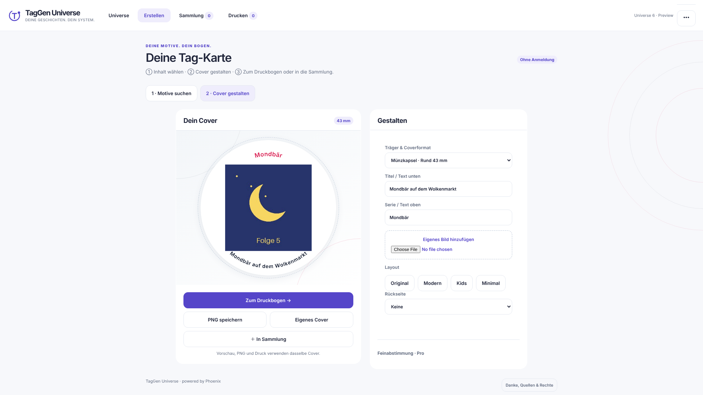

# TagGen Orbit · Universe 6.0 Preview

**Custom Tags gestalten, organisieren und für den Druck vorbereiten.**

[Web-App öffnen](https://stevenious.github.io/TagGen-Orbit/) · [English README](README.md) · [Fehler melden / Idee vorschlagen](https://github.com/Stevenious/TagGen-Orbit/issues)

TagGen Orbit ist ein browserbasiertes Werkzeug für individuelle Cover, die Organisation physischer Custom Tags und die Vorbereitung von A4-Druckbögen. Cover-Studio, Sammlung, Drucklayouts und lesende NFC-Werkzeuge sind in einer Anwendung gebündelt.

> **Projektstatus:** Universe 6.0 Preview. Die Anwendung ist nutzbar. Hardware-Kompatibilität, Druckerausrichtung und einzelne geräteabhängige Abläufe müssen weiterhin in der Praxis geprüft werden. Feedback ist willkommen.

## Was du mit Orbit machen kannst

_Die Screenshots zeigen die Anwendung mit erfundenen Demodaten (Titel, Cover und Tag-UIDs)._

### Cover gestalten
- Katalogeinträge suchen und vorhandene Coverbilder als Ausgangspunkt verwenden.
- Eigene Bilder nutzen – einzeln oder als Stapel mit bis zu 12 PNG-, JPEG- oder WebP-Dateien.
- Runde oder quadratische Designs bearbeiten, Layouts anpassen und optional eine Rückseite gestalten.
- Unsichere Dateinamen-Zuordnungen werden nur als Vorschlag angezeigt und müssen bestätigt werden.

### Physische Tags organisieren
- Mehrere benannte Sammlungen verwalten. Jede Sammlung hat bis zu 12 Arbeitsplätze.
- **Inhaltsmetadaten**, **Audio-ID**, **NFC-Tag-UID** und **physischer Träger bzw. Format** bleiben getrennte Angaben.
- Einträge ergänzen, austauschen, prüfen und verschieben, ohne unbeteiligte Cover- oder Tag-Daten stillschweigend zu verändern.
- Der Tag-Pass zeigt, was bekannt und zugeordnet ist und wo noch Angaben fehlen.

### Druckbögen vorbereiten
- Cover auf A4-Druckbögen anordnen und über den Druckdialog des Browsers drucken oder als PDF speichern.
- Verfügbare Formate:
  - Münzkapsel · 43 mm · 12 Plätze
  - Avery 6223-10 · 30 mm · 48 Plätze
  - Avery L3415-10 · 40 mm · 24 Plätze
  - Freie runde Formate: 25 mm, 30 mm und 40 mm
- Optionale Rückseiten können QR-Informationen und Tag-Angaben enthalten.
- Druckerkalibrierung und Duplex-Einstellungen sind – soweit unterstützt – vorhanden.

**Drucktipp:** Zuerst einen Probedruck auf normalem Papier machen. Im Druckdialog 100 % / tatsächliche Größe wählen und Skalierung, Ränder sowie Wendekante prüfen, bevor Etikettenpapier verwendet wird. Die tatsächliche Passung hängt von Drucker und Treiber ab.

### NFC-Tags lesen und prüfen (optionale Hardware)
- Vorhandene Flipper-NFC-Dateien importieren und die ausgelesenen Angaben prüfen.
- Optional einen kompatiblen **ESP32 + PN5180** mit NFC-Archiver-Firmware über Web Bluetooth verbinden.
- Tag-Informationen lesen und mit einem bekannten Eintrag vergleichen. Veränderte oder mehrdeutige Daten werden nicht automatisch als Treffer behandelt.
- Auf iPhone/iPad kann der BLE-Reader einen Web-Bluetooth-fähigen Browser wie [Bluefy](https://apps.apple.com/app/id1492822055) benötigen. Covergestaltung, Sammlungen, Druck und NFC-Dateiimport funktionieren auch in Safari ohne Reader.

**Bewusst nur lesend:** Orbit schreibt keine NFC-Tags, ändert keine UIDs, entsperrt keinen geschützten Speicher und verwaltet keine Tag-Passwörter. Eine erkannte UID oder ein passender Dump beweist weder den Audioinhalt noch die Echtheit eines Tags.

## TeddyCloud: ergänzt den Ablauf, synchronisiert aber nicht

Orbit kann beim Gestalten des Covers und beim Dokumentieren der Zuordnung zwischen Inhalt und physischem Tag helfen. Anschließend kannst du Inhalt und Bild in deiner eigenen TeddyCloud-Installation dem Custom Tag zuweisen.

Es gibt **keine direkte TeddyCloud-Synchronisierung und keine API-Verbindung**. Orbit ist eine statische GitHub-Pages-Anwendung und erhält keine TeddyCloud-Zugangsdaten. Ein gedrucktes Cover, eine Orbit-Projektdatei oder ein QR-Code ändert die TeddyCloud-Konfiguration nicht automatisch.

Hilfreiche externe Dokumentation:
- [TeddyCloud-Anleitung für Custom Tags](https://tonies-wiki.revvox.de/docs/tools/teddycloud/usage/custom-tags/)
- [TeddyCloud: eigene Metadaten und Bilder](https://tonies-wiki.revvox.de/docs/tools/teddycloud/tecdoc/tonies-custom-json/)

## Schnellstart

### Die gehostete Web-App verwenden
1. [TagGen Orbit öffnen](https://stevenious.github.io/TagGen-Orbit/).
2. Einen Katalogeintrag suchen oder ein eigenes Bild auswählen.
3. Cover anpassen und einer Sammlung hinzufügen.
4. Physisches Format festlegen und bei Bedarf eine vorhandene NFC-Datei zuordnen.
5. Druckbogen vorbereiten und im Browser **Drucken** wählen.

Für die normale Nutzung ist weder ein Konto noch eine Installation erforderlich.

### Als App installieren
In unterstützten Browsern die Funktion **App installieren** verwenden. Auf iPhone/iPad in Safari **Teilen → Zum Home-Bildschirm** wählen. Nach einem erfolgreichen Online-Aufruf kann die Anwendungshülle für einen Offline-Start zwischengespeichert werden.

### Lokal starten
Das Projekt ist eine statische Website. Das Repository-Verzeichnis über HTTP bereitstellen, zum Beispiel:

    git clone https://github.com/Stevenious/TagGen-Orbit.git
    cd TagGen-Orbit
    python3 -m http.server 8000

Danach [http://localhost:8000](http://localhost:8000) öffnen.

Für GitHub Pages müssen die Anwendungsdateien gemeinsam veröffentlicht werden: index.html, universe.js, universe.css, sw.js, manifest.webmanifest und das Verzeichnis assets/.

## Daten und Datenschutz

- Es gibt kein Orbit-Konto und keine zentrale Orbit-Sammlungsdatenbank.
- Sammlungen und Projektdaten liegen im Browser (wenn verfügbar in IndexedDB, mit localStorage-Ausweichlösung).
- Private Sicherungen entstehen erst durch einen bewussten Export. Bitte eigene Backups aufbewahren: Beim Löschen der Website-Daten können lokal gespeicherte Arbeiten verloren gehen.
- Eine private .taggen-Projektdatei kann das Arbeitsprojekt sichern. Sammlungs- und Bibliotheksexporte verwenden .orbit-collection und .orbit-library.
- Das **öffentliche Cover-Paket** entfernt Audio-IDs und NFC-Daten. Teile nur Bilder, für die du die nötigen Weitergaberechte hast.
- Der Offline-Service-Worker speichert die Anwendungshülle, nicht private Projekte, NFC-Dumps, externe Katalogdaten oder fremd gehostete Coverbilder.
- Beim Aufruf von GitHub Pages sowie bei Anfragen an externe Kataloge, Community-Indizes oder Bildquellen werden Verbindungsdaten an die jeweiligen Anbieter übertragen. Details stehen in [CREDITS_AND_RIGHTS.md](CREDITS_AND_RIGHTS.md).

## Kataloge, Community-Daten und Danksagung

Orbit nutzt oder fragt optional externe Community-Ressourcen ab. Diese werden von ihren jeweiligen Maintainerinnen und Maintainer gepflegt; die Nennung bedeutet keine Unterstützung oder Partnerschaft.

- [tonies-json](https://github.com/toniebox-reverse-engineering/tonies-json) · Katalogmetadaten und Bildverweise
- [flipper-zero-tonies](https://github.com/nortakales/flipper-zero-tonies) · optionale Suche nach Community-NFC-Dumps
- [L480/tonies](https://github.com/L480/tonies) · optionaler UID-Index
- [NFC-Archiver](https://github.com/RFIDfriend/NFC-Archiver) · Dokumentation für Reader und BLE-Protokoll
- [TeddyCloud](https://github.com/toniebox-reverse-engineering/teddycloud) · Referenz für den Custom-Tag-Ablauf
- [QR Code Generator von Kazuhiko Arase](https://github.com/kazuhikoarase/qrcode-generator) · eingebettete QR-Implementierung (MIT)

Einige externe Repositories weisen im Stammverzeichnis keine Lizenz aus. Öffentliche Verfügbarkeit bedeutet nicht automatisch, dass Daten, Bilder oder Dumps weiterverbreitet werden dürfen. Mehr dazu: [Quellen, Danksagung und Rechte](CREDITS_AND_RIGHTS.md).

## Tests und bekannte Grenzen

Das Repository enthält automatisierte Prüfungen für Sammlungsintegrität, Import/Export, Druckgeometrie, Browserabläufe und Offline-Anwendungshülle. Der Workflow **Universe V6 checks** führt die entsprechenden automatisierten Tests aus.

Automatisierte Tests ersetzen keine Geräteprüfung. Folgende Punkte müssen auf dem tatsächlichen Zielsystem geprüft werden:
- Druckerausrichtung, Etikettenmaterial und Duplex-Wendekante.
- Reale Kombinationen aus Reader, Firmware und unterstützten Tagtypen.
- Browserabhängiges BLE-Verhalten, insbesondere unter iOS.
- Offline-Verfügbarkeit externer Katalogeinträge und Bilder.

Weitere Details: [UNIVERSE_V6.md](UNIVERSE_V6.md), [CHANGELOG.md](CHANGELOG.md) und [TEST_REPORT.md](TEST_REPORT.md).

## Feedback und Mitarbeit

Fehler gefunden oder eine Idee? [Issue eröffnen](https://github.com/Stevenious/TagGen-Orbit/issues). Hilfreich sind:
- Browser und Version, Gerät und Betriebssystem.
- Was du erwartet hast und was stattdessen passiert ist.
- Schritte zum Nachstellen und bei Bedarf ein Screenshot ohne persönliche Daten.

Bitte keine privaten NFC-Dumps, Zugangsdaten oder persönlichen Sammlungs-Backups in öffentliche Issues hochladen.

TagGen Orbit wird derzeit ohne allgemeine Open-Source-Lizenz veröffentlicht. Das Repository ist öffentlich einsehbar; daraus entsteht **keine Erlaubnis**, den Projektquellcode oder die Projektgrafiken weiterzuverwenden, zu verändern oder weiterzuverbreiten. Der eingebettete QR-Code-Bestandteil behält seinen eigenen MIT-Hinweis. Bitte vor einer Code-Weiterverwendung oder Kooperation zuerst ein Issue eröffnen.

## Projektidentität

TagGen Orbit / TagGen Universe ist ein unabhängiges Community-Projekt. **Tonie** und **Toniebox** sind Namen und Marken ihrer jeweiligen Rechteinhaber. Dieses Projekt ist nicht mit der tonies GmbH verbunden und wird von ihr weder unterstützt noch gesponsert.

---

[English · English documentation](README.md) · [Web-App öffnen](https://stevenious.github.io/TagGen-Orbit/) · [Repository](https://github.com/Stevenious/TagGen-Orbit)
